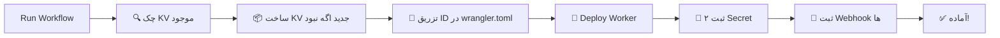

<div align="center">

# 🚀 PRPoxy

### **پل ارتباطی بین تلگرام و سروش، در دلِ قطعی اینترنت**

**استخراج خودکار کانفیگ‌های VPN و پروکسی از کانال‌های تلگرام — بدون ذخیره‌سازی، بدون واسطه، بدون قطعی**

[](https://github.com/YOUR_USERNAME/prpoxy/actions/workflows/deploy.yml)
[](https://workers.cloudflare.com/)
[](https://opensource.org/licenses/MIT)
[](#)

</div>

---

## 🌐 چرا PRPoxy؟

وقتی اینترنت بین‌الملل قطع می‌شه، کاربر داخل ایران به **تلگرام دسترسی نداره** — ولی:
- ✅ به **سروش** دسترسی داره (پیام‌رسان داخلی)
- ✅ سرور **Cloudflare** (خارج از ایران) به تلگرام دسترسی داره
- ✅ Cloudflare به سروش دسترسی داره

**PRPoxy** این دو دنیا رو به هم وصل می‌کنه.

```
┌─────────────────┐      ┌──────────────────────┐      ┌─────────────────┐
│  کانال تلگرام   │ ───▶ │  Cloudflare Worker   │ ───▶ │   ربات سروش     │
│ (منبع کانفیگ)   │      │  (استخراج + رله)     │      │   (تحویل کاربر) │
└─────────────────┘      └──────────────────────┘      └─────────────────┘
        خارج ایران              خارج ایران              داخل ایران
```

> **نتیجه:** کاربر داخل ایران، بدون ذره‌ای دسترسی به تلگرام، آخرین کانفیگ‌های VPN رو از سروش می‌گیره. 🎯

---

## 🎯 چه چیزهایی استخراج می‌شن؟

<table>
<tr>
<td valign="top" width="50%">

### 🔐 پروتکل‌های VPN
- `vmess://` — V2Ray
- `vless://` — V2Ray (نوین)
- `trojan://` — Trojan
- `ss://` — Shadowsocks
- `ssr://` — ShadowsocksR
- `hysteria://` / `hysteria2://` / `hy2://`
- `tuic://` — TUIC
- `wireguard://` / `wg://`
- `socks://` / `socks5://`
- `http://` — HTTP Proxy

</td>
<td valign="top" width="50%">

### 🌐 پروکسی تلگرام
- `tg://proxy?...`
- `t.me/socks?...`
- `t.me/proxy?...`

### 📁 فایل‌های VPN
- `.ovpn` — OpenVPN
- `.conf` — WireGuard / OpenVPN
- `.json` — Sing-box / Clash
- `.yaml` / `.yml` — Clash
- `.mobileconfig` — iOS VPN Profile
- `.txt` / `.zip` / `.rar` / `.7z`
- `.pem` / `.key` / `.crt`

</td>
</tr>
</table>

**و مهم‌تر از همه:** متن «رمز» و توضیحاتی که در پست همراه کانفیگ نوشته شده، دست‌نخورده باقی می‌مونه. 📝

---

## ⚡ ویژگی‌های کلیدی

<table>
<tr>
<td align="center" width="25%">

### 🚀
**Deploy خودکار**
<br/>
<sub>یک کلیک. KV ساخته می‌شه، Secrets ثبت می‌شن، Webhook ها فعال.</sub>

</td>
<td align="center" width="25%">

### 🎨
**UI یکسان**
<br/>
<sub>تلگرام و سروش، دقیقاً همون دکمه‌ها و همون تجربه.</sub>

</td>
<td align="center" width="25%">

### 💾
**صفر ذخیره‌سازی**
<br/>
<sub>هیچ کانفیگی روی هیچ دیتابیسی نوشته نمی‌شه. فقط عبور می‌کنه.</sub>

</td>
<td align="center" width="25%">

### ⚡
**دریافت موازی**
<br/>
<sub>۱۰ منبع = ۱۰ درخواست همزمان با <code>Promise.all</code>.</sub>

</td>
</tr>
<tr>
<td align="center">

### 🔁
**حذف تکراری**
<br/>
<sub>کانفیگ تکراری بین منابع با Set سراسری حذف می‌شه.</sub>

</td>
<td align="center">

### 🔐
**فقط ۲ توکن**
<br/>
<sub>فقط <code>TELEGRAM_BOT_TOKEN</code> و <code>SOROUSH_BOT_TOKEN</code>.</sub>

</td>
<td align="center">

### 🆓
**رایگان**
<br/>
<sub>Cloudflare Workers: ۱۰۰ هزار درخواست روزانه، رایگان.</sub>

</td>
<td align="center">

### 🌍
**Open Source**
<br/>
<sub>هر کسی روی Worker خودش Deploy می‌کنه. هیچ dependency مشترکی نیست.</sub>

</td>
</tr>
</table>

---

## 🚀 راه‌اندازی — فقط ۳ دقیقه

### پیش‌نیازها

| چیز | چطور بگیرم؟ |
|---|---|
| حساب Cloudflare | [dash.cloudflare.com/sign-up](https://dash.cloudflare.com/sign-up) — رایگان |
| حساب GitHub | رایگان |
| توکن ربات تلگرام | از [@BotFather](https://t.me/BotFather) → `/newbot` |
| توکن ربات سروش | از ربات پدر سروش |

---

### 📍 قدم ۱: Fork

روی دکمهٔ بالا سمت راست **Fork** بزن. یک کپی از پروژه به حساب خودت می‌ره.

---

### 📍 قدم ۲: ساخت Cloudflare API Token

1. برو به [dash.cloudflare.com/profile/api-tokens](https://dash.cloudflare.com/profile/api-tokens)
2. **Create Token** → **Edit Cloudflare Workers**
3. Permissions:
   ```
   Account.Workers Scripts: Edit
   Account.Workers KV Storage: Edit
   Account.Account Settings: Read
   User.User Details: Read
   ```
4. Token رو کپی کن ✅

---

### 📍 قدم ۳: پیدا کردن Account ID

از [داشبورد Cloudflare](https://dash.cloudflare.com/) → سمت راست پایین → **Account ID** → کپی ✅

---

### 📍 قدم ۴: تنظیم ۴ Secret در GitHub

در ریپوی خودت:

**Settings → Secrets and variables → Actions → New repository secret**

| Secret | مقدار |
|---|---|
| `CLOUDFLARE_API_TOKEN` | توکن قدم ۲ |
| `CLOUDFLARE_ACCOUNT_ID` | شناسهٔ قدم ۳ |
| `TELEGRAM_BOT_TOKEN` | توکن BotFather |
| `SOROUSH_BOT_TOKEN` | توکن ربات سروش |

> 💡 **دقت کن:** اینا در GitHub Secrets هستن، نه در Worker. Worker فقط ۲ توکن لازم داره که Action به‌طور خودکار ست می‌کنه.

---

### 📍 قدم ۵: اجرا

برو به:
```
https://github.com/YOUR_USERNAME/prpoxy/actions
```

**Deploy PRPoxy** → **Run workflow** → **Run** ✅

---

### 🎉 چی خودکار انجام می‌شه؟



بعد از اتمام:
- Worker URL: `https://prpoxy.<account>.workers.dev`
- ربات تلگرام: آماده ✅
- ربات سروش: آماده ✅

هر `push` به `main` هم دوباره Deploy می‌کنه. 🔄

---

## 🎮 تجربهٔ کاربری

### 🏠 منوی اصلی

```
👋 خوش آمدی به PRPoxy

🔧 منوی اصلی:
· افزودن منبع (کانال تلگرام)
· دریافت کانفیگ از یک یا همه منابع
· مدیریت لیست منابع

┌──────────────────────────┐
│  ➕ افزودن منبع          │
├──────────────────────────┤
│  📥 دریافت فایل          │
├──────────────────────────┤
│  ⚙️ تنظیمات              │
└──────────────────────────┘
```

---

### 📥 صفحهٔ منابع

```
📋 منابع شما (3):

1. https://t.me/s/v2ray_configs
2. https://t.me/s/freev2ray
3. https://t.me/s/proxy_list

┌────────────────────────────┐
│  📥 v2ray_configs  │  🗑    │
├────────────────────────────┤
│  📥 freev2ray      │  🗑    │
├────────────────────────────┤
│  📥 proxy_list     │  🗑    │
├────────────────────────────┤
│  📥 دریافت از همه منابع    │ ← موازی، سریع
├────────────────────────────┤
│  ➕ افزودن منبع            │
├────────────────────────────┤
│  🔙 بازگشت                 │
└────────────────────────────┘
```

---

### 📤 نمونهٔ خروجی

```
📦 47 کانفیگ یکتا از 3/3 منبع

🌐 https://t.me/s/v2ray_configs
📅 2024-11-05 14:23:11
📝 رمز: iran123 — سرور آلمان، پینگ پایین
vmess://eyJ2IjoiMiIsInBzIjoi...
vmess://eyJ2IjoiMiIsInBzIjoi...
📎 https://example.com/config.ovpn

🌐 https://t.me/s/freev2ray
📅 2024-11-05 12:00:00
📝 تست‌شده — ۱۰۰٪ کار می‌کنه
vless://abc-123-def@1.2.3.4:443?...
tg://proxy?server=1.2.3.4&port=443&secret=...

🌐 https://t.me/s/proxy_list
❌ HTTP 404
```

> 🎯 **توجه:** متن «رمز: iran123» همون‌طور که در پست اصلی بود، همراه کانفیگ اومد.

---

## ⌨️ دستورات متنی (اختیاری)

| دستور | کار |
|---|---|
| `/start` | منوی اصلی |
| `/menu` | منوی اصلی |
| `/help` | راهنما |
| `/sources` | لیست منابع با دکمه‌ها |
| `/fetch <url>` | دریافت یک‌باره از URL |
| `/fetchall` | دریافت موازی از همهٔ منابع ثبت‌شده |

---

## 🏗 معماری فنی

### 🔄 جریان داده

```
┌───────────────────────────────────────────────────────────────┐
│                         USER (داخل ایران)                     │
│                    از طریق اپ سروش کار می‌کنه                │
└────────────────────────────┬──────────────────────────────────┘
                             │
                             ▼
              ┌──────────────────────────────┐
              │    Soroush Bot API           │
              │    (api.splus.ir)            │
              └──────────────┬───────────────┘
                             │
              ┌──────────────▼───────────────┐
              │      CLOUDFLARE WORKER       │
              │  ┌────────────────────────┐  │
              │  │  1. getUpdates (cron)  │  │
              │  │  2. Scrape t.me/s/     │  │
              │  │  3. Extract regex      │  │
              │  │  4. sendMessage back   │  │
              │  └────────────────────────┘  │
              └──────────────┬───────────────┘
                             │
                             ▼
              ┌──────────────────────────────┐
              │   Telegram t.me/s/<channel>  │
              │   (HTML scrape، بدون API)    │
              └──────────────────────────────┘
```

---

### 🧩 معماری فایل

```
prpoxy/
│
├── .github/
│   └── workflows/
│       └── deploy.yml        ← 🚀 Deploy + KV + Webhook (خودکار)
│
├── worker.js                  ← 🧠 منطق (کامنت کامل فارسی)
│   ├── بخش ۱ — Regex
│   ├── بخش ۲ — ابزارها
│   ├── بخش ۳ — Scraper
│   ├── بخش ۴ — KV
│   ├── بخش ۵ — آداپتر پلتفرم
│   ├── بخش ۶ — کیبوردها
│   ├── بخش ۷ — Callback
│   ├── بخش ۸ — Message
│   ├── بخش ۹ — Router
│   └── بخش ۱۰ — Entry
│
├── wrangler.toml              ← ⚙️ تنظیمات CF
├── package.json               ← 📦
├── .gitignore                 ← 🚫
└── README.md                  ← 📖 (همین فایل)
```

---

### 🔀 چرا سروش polling داره ولی تلگرام webhook؟

| پلتفرم | روش | چرا؟ |
|---|---|---|
| **تلگرام** | Webhook | تلگرام (خارج) می‌تونه CF رو صدا بزنه ✅ |
| **سروش** | Cron polling هر ۱ دقیقه | سروش (داخل) ممکنه نتونه CF رو صدا بزنه — پس CF خودش می‌ره سراغش ✅ |

اگه می‌خوای سروش هم webhook داشته باشه (وقتی اینترنت بین‌الملل وصله):
```
wrangler.toml → [vars]
SOROUSH_USE_WEBHOOK = "true"
```

---

### 💾 ذخیره‌سازی

| داده | محل | چرا؟ |
|---|---|---|
| لیست منابع (`https://t.me/s/...`) | KV (`sources:<chatId>`) | برای «دریافت از همه» |
| وضعیت کاربر (`awaiting_source`) | KV (`state:<chatId>`) | فقط موقع افزودن منبع |
| cursor سروش (`update_id`) | KV (`sr_offset`) | برای polling |
| **کانفیگ‌های VPN** | ❌ **هیچ‌جا** | ❌ ذخیره نمی‌شن |
| **فایل‌های VPN** | ❌ **هیچ‌جا** | ❌ ذخیره نمی‌شن |
| **توکن‌ها** | Worker Secrets | رمزنگاری‌شده توسط CF |

**اصل طراحی:** کانفیگ‌ها فقط از تلگرام می‌رن به سروش و تمام. هیچ نسخهٔ پشتیبانی وجود نداره. 🎯

---

## ⚙️ شخصی‌سازی

کد کامل کامنت‌گذاری شده. جدول زیر نقاط کلیدی برای تغییره:

| می‌خوای چیکار کنی | کجا | چطور |
|---|---|---|
| **پروتکل جدید** اضافه کنی | `CONFIG_REGEX` | یک آیتم به regex اضافه کن |
| **پسوند فایل جدید** | `FILE_LINK_REGEX` | `< پسوند` جدید به لیست اضافه کن |
| **دکمهٔ جدید** به منو | `kbMain()` | یک آیتم به `inline_keyboard` اضافه کن |
| **متن پیام‌ها** | `onCallback` / `onMessage` | رشته رو ویرایش کن |
| **آدرس API سروش** | `wrangler.toml → [vars]` | `SOROUSH_API_BASE` رو عوض کن |
| **زمان Cron** | `wrangler.toml → [triggers]` | `crons` رو تغییر بده |
| **اسم پروژه** | `wrangler.toml → name` | هرچی می‌خوای |

---

## 🐛 عیب‌یابی

<details>
<summary><b>❌ ربات تلگرام جواب نمی‌ده</b></summary>

1. برو به `https://<worker-url>/setup` و ببین آیا `"ok": true` برمی‌گرده
2. توکن تلگرام رو چک کن — باید با `/getMe` کار کنه:
   ```
   curl https://api.telegram.org/bot<TOKEN>/getMe
   ```
3. Webhook رو چک کن:
   ```
   curl https://api.telegram.org/bot<TOKEN>/getWebhookInfo
   ```
4. اگه `last_error_message` داشت، اون رو بخون

</details>

<details>
<summary><b>❌ ربات سروش جواب نمی‌ده</b></summary>

1. Worker → **Logs** → **Live** → پیام بفرست → خطا رو ببین
2. توکن سروش رو تست کن:
   ```
   curl -X POST https://api.splus.ir/bot<TOKEN>/getMe
   ```
3. اگه `ok: true` بود ولی ربات جواب نمی‌ده → مشکل در `getUpdates` هست
4. اگه cron فعاله (هر ۱ دقیقه)، بعد از ۱ دقیقه جواب می‌ده — صبور باش ⏳

</details>

<details>
<summary><b>❌ «HTTP 404» موقع دریافت از کانال</b></summary>

- کانال **public** نیست؟ → `t.me/s/` فقط برای کانال‌های عمومی کار می‌کنه
- کانال **web preview** رو غیرفعال کرده؟ → امکان‌پذیره صاحب کانال این تنظیم رو بسته باشه
- اسم کانال رو اشتباه زدی؟ → `t.me/s/<channel_name>` رو دستی توی مرورگر باز کن

</details>

<details>
<summary><b>❌ «چیزی پیدا نشد»</b></summary>

- کانال واقعاً کانفیگ نداره؟ اولین پست‌ها رو دستی چک کن
- کانفیگ به‌صورت **عکس** هست؟ → ما فقط HTML و متن رو می‌خونیم، عکس (OCR) پشتیبانی نمی‌شه
- کانفیگ داخل **فایل ZIP** هست؟ → فقط **لینک** فایل استخراج می‌شه، نه محتواش

</details>

<details>
<summary><b>❌ GitHub Action fail می‌شه</b></summary>

| خطا | راه‌حل |
|---|---|
| `Authentication error` | `CLOUDFLARE_API_TOKEN` رو چک کن — باید `Workers Scripts:Edit` و `Workers KV:Edit` داشته باشه |
| `KV namespace not found` | `CLOUDFLARE_ACCOUNT_ID` رو چک کن |
| `wrangler not found` | باید `npm install -g wrangler@3` اجرا بشه — توی workflow هست |
| `sed: no such file` | `wrangler.toml` توی ریپو نیست — مطمئن شو Fork کامل بوده |

</details>

<details>
<summary><b>❌ Cron اجرا نمی‌شه</b></summary>

1. `wrangler.toml` باید `[triggers]` داشته باشه با `crons = ["* * * * *"]`
2. Worker → **Settings → Triggers** → چک کن Cron فعاله
3. اگه `SOROUSH_USE_WEBHOOK = "true"` باشه، cron خودش رو غیرفعال می‌کنه — عمداً

</details>

---

## 🔐 امنیت

- ✅ **توکن‌ها** فقط در Worker Secrets (رمزنگاری‌شده توسط CF) — هیچ‌جا در کد نیستن
- ✅ **هیچ کانفیگی** ذخیره نمی‌شه — نه در KV، نه در لاگ، نه در D1
- ✅ **اختیاری:** با ست‌کردن `ADMIN_TELEGRAM_ID` و `ADMIN_SOROUSH_ID`، ربات فقط برای تو کار می‌کنه
- ✅ **Open Source** — کد قابل audit هست، هر کسی می‌تونه fork کنه و روی Worker خودش Deploy کنه
- ✅ **بدون tracking** — هیچ analytics، هیچ telemetry

---

## 💰 هزینه

| سرویس | پلن رایگان | برای PRPoxy کافیه؟ |
|---|---|---|
| Cloudflare Workers | ۱۰۰,۰۰۰ req/day | ✅ بله (هر کاربر ~۱۰-۲۰ req) |
| Cloudflare KV | ۱۰۰,۰۰۰ read/day, ۱۰۰۰ write/day | ✅ بله (فقط منابع) |
| Cloudflare Cron | نامحدود | ✅ بله |
| GitHub Actions | ۲۰۰۰ min/month | ✅ بله (deploy ~۱ دقیقه) |

**جمع:** ۱۰۰٪ رایگان برای ده‌ها کاربر. 🆓

---

## 🗺 نقشه راه

- [x] استخراج چند-پروتکلی
- [x] UI کامل در سروش و تلگرام
- [x] Deploy کاملاً خودکار
- [x] دریافت موازی
- [x] حذف تکراری سراسری
- [ ] 📎 ارسال به‌صورت فایل `.txt` (به‌جای متن طولانی)
- [ ] 🏷 فیلتر پروتکل (فقط vmess، فقط vless...)
- [ ] 🕐 به‌روزرسانی خودکار منابع هر X ساعت
- [ ] 📊 داشبورد آمار (تعداد منابع، تعداد دریافت)
- [ ] 🌍 Multi-language (EN/FA)
- [ ] 🔔 نوتیفیکیشن پست‌های جدید (تفاوت با دریافت قبلی)

> 💡 **پیشنهاد داری؟** [Issue باز کن](../../issues)

---

## 🤝 مشارکت

Pull Request ها خوش‌آمدن! 🙌

1. Fork کن
2. برنچ بساز: `git checkout -b feature/amazing`
3. کامیت کن: `git commit -m "Add amazing feature"`
4. Push کن: `git push origin feature/amazing`
5. PR باز کن

---

## 📜 مجوز

MIT — هر کاری می‌خوای بکن. تجاری، شخصی، خصوصی، عمومی. فقط اسم پروژه رو نگه دار. ✌️

---

<div align="center">

### 🌟 اگه PRPoxy برات مفید بود، یه ستاره بده ⭐

**ساخته‌شده برای مردمی که حتی وقتی اینترنت قطع می‌شه، متصل می‌مونن.**

```
        ﴿ وَمَن يَتَّقِ اللَّهَ يَجْعَل لَّهُ مَخْرَجًا ﴾
```

</div>